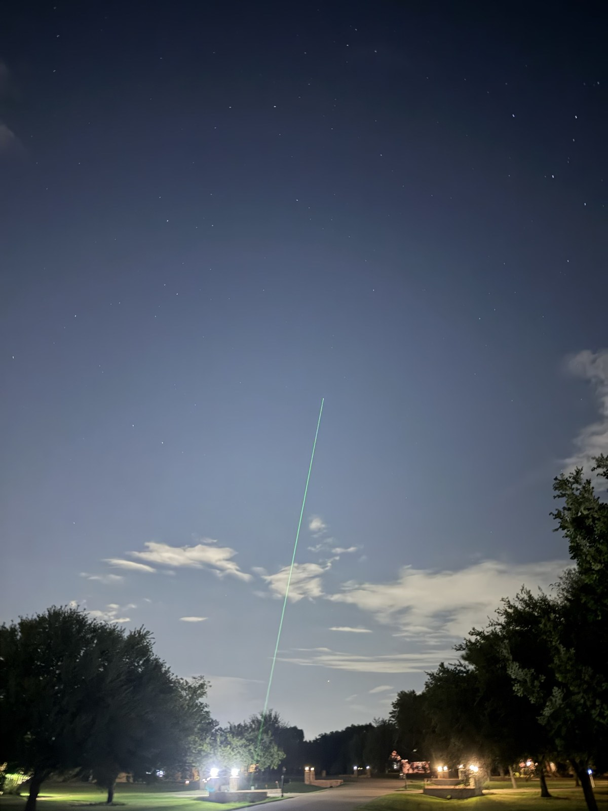
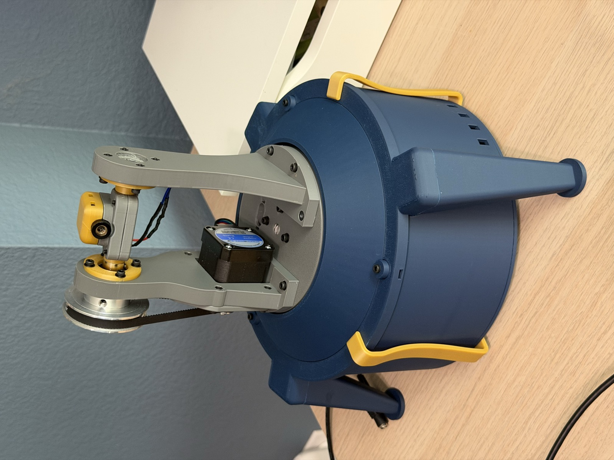
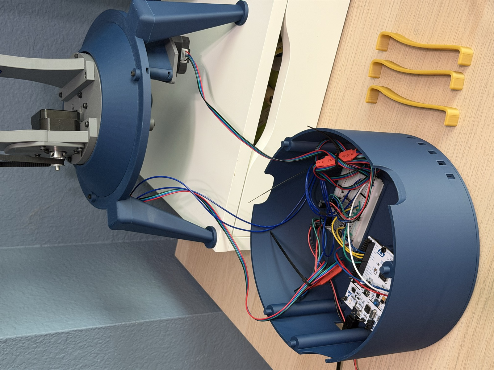
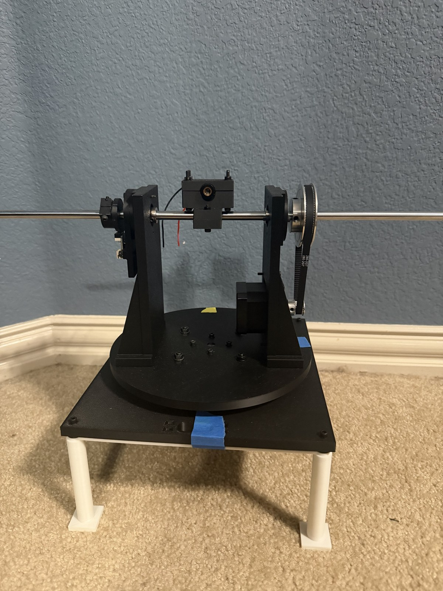
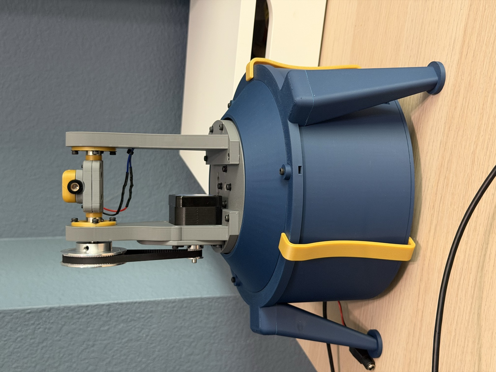
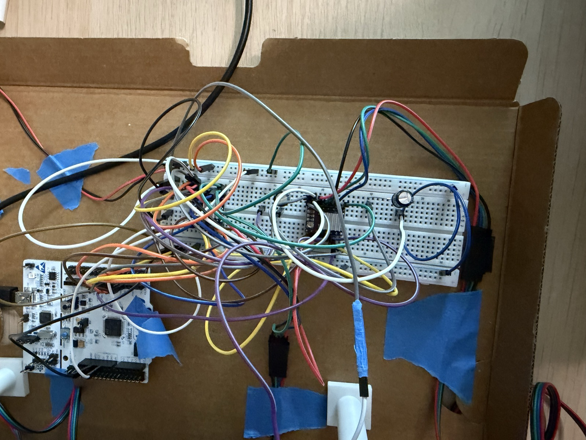
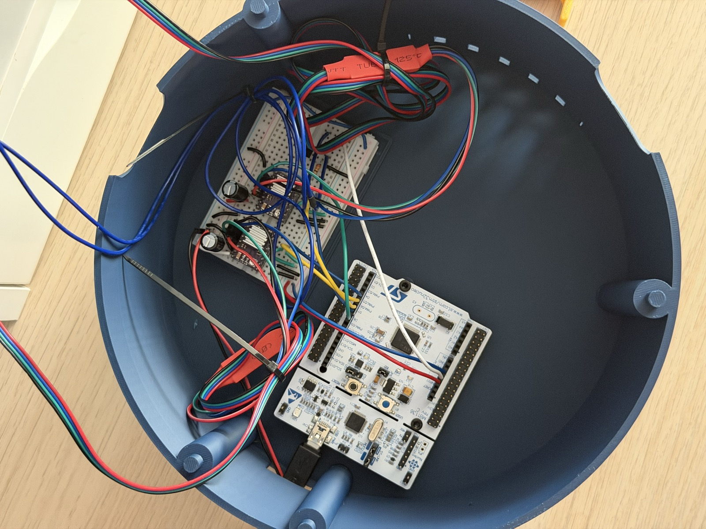
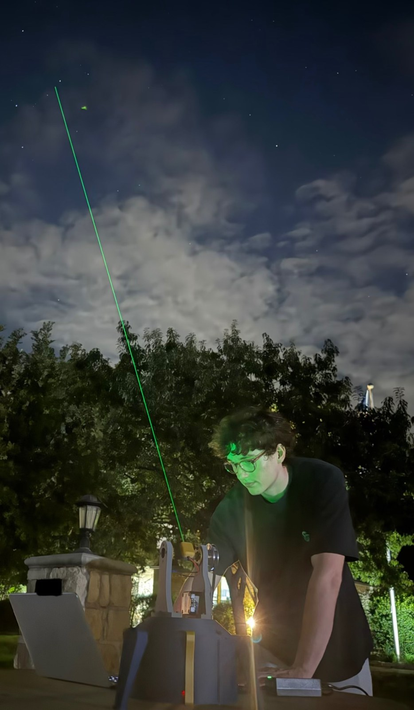

# Star Pointer

A two-axis motorized mount that points a laser at any star you pick on your
laptop or phone. It works out where to aim from your location, the current time, and a
two-star alignment done at setup.



**Status:** working v2 mount. Measured accuracy on the sky is
**0.33° RMS, 0.44° worst** across 8 stars, against a 0.5° design target, 
about the width of the full moon.

## Why I built this

I’ve always loved space and astronomy, and I wanted a hardware project built 
around that. This one ended up covering a little of everything: STM32 firmware,
stepper motion control, a 3D printed mount I went through two versions of, and 
the coordinate math to turn a star name into motor steps.

## The build

<p align="center">
  
  
</p>

v1 was an open frame with a full breadboard of jumpers sitting next to it. 
It got the firmware, the math and the first sky tests working. v2 is the 
cleaned-up version: a printed fork on a 120 mm turntable, both belts at 
fixed center distances so nothing needs tensioning, a cable loop that lets 
it turn half a turn each way, and all the electronics inside the base on a 
floor that unclips.

| v1 | v2 |
|---|---|
|  |  |
|  |  |

The v2 board is the same circuit rebuilt on a half breadboard with solid wire
cut to length. Print files, editable STEP files, the full assembly and the
fastener list are in [`hardware/cad/v2`](hardware/cad/v2).

## Architecture

This project splits into four jobs: find the star, know where the mount is
actually pointed, convert angles to steps, and generate the pulses.

Pulse generation has to be on the STM32 for microsecond timing and an
instant stop. The astronomy has to be on the laptop, because that's
where the catalog and the UI live.

Step conversion lives in Python for now. Two-star alignment needs the same 
math, and prototyping it in Python was faster to debug. The firmware 
stays simple: it takes step moves, reports position, and handles the laser 
and stop. Porting the conversion to the STM32 is a possible later step.

The interface between the two sides is a small text command set over USB 
serial: move, status, stop, and laser.

```
  Laptop (Python)                    STM32                   Mechanics
  ---------------                    -----                   ---------
  star catalog          USB serial   command parser          NEMA 17 x2
  RA/Dec -> Alt/Az      -------->    step generation  ---->  4:1 GT2 belt
  two-star alignment    <--------    position count          alt-az fork
  angles -> steps        status      laser + auto-off        laser
  web UI (phone/laptop)              stop
```

## Repo layout

| Path | Contents |
|---|---|
| `app/` | Python host application |
| `firmware/` | STM32 firmware |
| `hardware/` | BOM, dimensions, CAD files, bench notes |
| `docs/` | Design decisions, error budget, serial protocol |
| `data/` | Accuracy test log |
| `start.command` | Double-click launcher for the web app |

## Running the coordinate engine

Standard library only, no install step.

```bash
cd app
python3 skycoords.py        # current alt/az for every catalog star
python3 test_skycoords.py   # validation suite
```

## Running the mount

Needs Flask and pyserial: `pip3 install flask pyserial`.

Plug in the Nucleo's USB and the 12V supply, then double-click `start.command`.
It finds the Nucleo's serial port, starts the web app, and opens it in the
browser. The Terminal window also prints the address for a phone on the same
wifi. Closing that window stops the app and switches the laser off.

From a terminal instead:

```bash
python3 -m app.align   # desk test: simulated tilted mount, no hardware needed
python3 -m app.web     # web UI on http://localhost:8000
```

## Using it outside

1. Stage facing roughly south. That puts the cable limit (half a turn either
   way) due north, where few stars cross. The laser can rest at any angle.
2. 12V on first, so the motors lock the mount in place, then double-click
   `start.command`.
3. Jog the beam onto a bright star, sighting straight down the beam from behind
   the laser, pick it in the Align list, and tap "Beam is on this star."
4. The Align list now ranks every other star as a partner for the first one.
   Pick one rated "good" and do the same.
5. Tap any star in the list to point at it.

Choosing the second star matters more than it may seem. With the same 0.1°
centering slip, a good pair keeps every GOTO within about 0.1°, while a poor
one can throw some off by several degrees. The app simulates each pair and
rates it.

**Measuring accuracy:** after a GOTO, jog the beam onto the star and tap
"Centered." The app logs how far the GOTO landed from the star, and in which
direction, to `data/accuracy.csv`, and shows the RMS and worst miss for the
current alignment. Alignment stars are logged but left out of the stats.

Never point it at aircraft. The laser turns itself off 60 seconds after the
last command if the app goes away.

## Results so far

- **Step scale and backlash (wall test at 2.9 m):** 100 steps moved the beam
  2.8° on both axes, matching the gear math. Repeated moves with direction
  reversals landed back within about half a millimeter, under 0.01°.
- **First on-sky GOTO (Oct 6, 2026):** aligned on Altair and Vega from a
  driveway sloped about 4°. Alignment reported the base 3° off level and the
  laser's starting angle within 0.1°, both matching the real setup. GOTO to
  Deneb and Polaris landed on the star with no manual correction.
- **Pointing accuracy (Oct 14, 2026, v2 mount):** aligned on Altair and Vega,
  then sent GOTOs to 8 other stars between 52° and 78° altitude and measured
  each miss: **0.33° RMS, 0.44° worst**, inside the 0.5° target. Raw log in
  [`data/accuracy.csv`](data/accuracy.csv).
- **What's left in the error:** the misses definitely follow a pattern. Stars
  higher than the alignment stars land to the right and lower ones to the left.
  A second alignment (Vega and Scheat) missed Mizar and Alkaid, 11° above the
  horizon, by 1.1°. That pattern comes from a mount error the two-star model
  isn't aware of: either the laser sits about 0.9° off square in its capsule,
  or the altitude axis leans about 0.6° relative to the azimuth axis. Fitting
  either one to the log cuts the side-to-side error from 0.50° to about 0.1
  to 0.15°. Next step is adding both terms to the pointing model and checking
  it on a new night.

<p align="center">
  
</p>
<p align="center"><em>Running the accuracy test, Oct 14, 2026</em></p>

Details in `hardware/bench-notes.md`.

## Validation

The transform is checked against physical facts rather than against another
library. If a check fails, its name points at the specific thing that broke.
Comparing to a reference implementation would only tell me the two disagree,
not where or which one is wrong.

15 checks, all passing.

## References

Sidereal time, Julian date, and precession formulas follow Meeus,
*Astronomical Algorithms*. Refraction uses Bennett's formula.

## Progress

- [x] RA/Dec to alt/az transform, precession, refraction
- [x] Validation suite
- [x] STM32 stepper control, both axes
- [x] Endstop homing (built and tested, then dropped since two-star alignment handles it)
- [x] Prototype mount built
- [x] Azimuth zero (stage faces south at startup; switch homing kept as a test tool)
- [x] Serial protocol spec
- [x] Laser wiring and interlock
- [x] Laser auto-off timer
- [x] Two-star alignment
- [x] End-to-end GOTO
- [x] Accuracy measurement across the sky
- [x] v2 mount: smaller frame, cable routing, electronics enclosure
- [ ] Pointing model terms for laser cone and axis tilt
- [ ] Sidereal tracking
- [ ] Custom PCB
