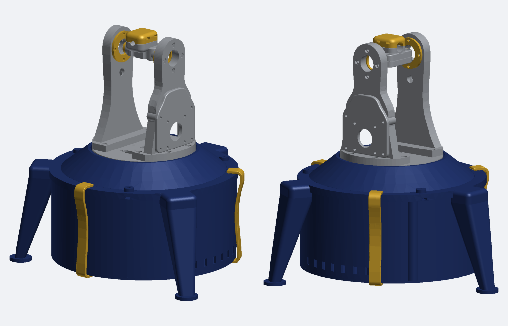

# v2 mount CAD

All units mm. `stl/` files are already in print orientation. `step/` files are
the editable solids in assembly coordinates (az axis on Z, turntable top at
Z = 0), so they drop into place together. `assembly.step` is every printed
part in position.

Part numbers match the bench notes. There is no part 09.

## Printed parts

PLA, 0.4 mm nozzle, 0.20 mm layers unless noted.

| File | Qty | Color | Notes |
|---|---|---|---|
| `01-turntable` | 1 | grey | Rotating plate on the lazy susan |
| `02-bearing-spacer` | 1 | any | Spaces the lazy susan inner ring |
| `03-fork-left` | 1 | grey | Bearing side. Feet down, tree supports, brim |
| `04-fork-right` | 1 | grey | Motor side. Feet down, 6 walls, 40-50% gyroid, brim, normal supports under the crossbar |
| `05-alt-motor-plate` | 1 | grey | Sets the 88.2 mm alt belt center distance |
| `06-bearing-retainer` | 2 | gold | Holds each 608 bearing in its fork |
| `07-laser-capsule-base` | 1 | grey | Clamps to the alt shaft |
| `08-laser-capsule-cap` | 1 | gold | Seam face down, no supports in the nut slots |
| `10a-deck` | 1 | navy | Top face down. Includes the motor screw reliefs |
| `10b-collar` | 1 | navy | 0.16 mm layers, 4 walls, supports off, brim on the bed contact only |
| `11-az-motor-plate` | 1 | any | Sets the 72.8 mm az belt center distance |
| `12-az-shaft-hub` | 1 | any | Clamps the az shaft to the turntable |
| `13-cable-well` | 1 | any | Holds the cable service loop for ±180° of az travel |
| `14-electronics-shell` | 1 | navy | Pegs locate it on the deck |
| `15-electronics-floor` | 1 | navy | Holds the Nucleo and half breadboard |
| `16-leg` | 3 | navy | All three are the same part |
| `17-capsule-spacer` | 2 | gold | 0.10 mm layers, should measure 4.1 mm |
| `18-shell-clip` | 3 | gold | Holds the shell and floor on without glue. 4 walls, 100% infill, no supports |

## Assembly tools (`tools/`)

Printed gauges that set pulley heights and the alt shaft position during
assembly. 0.10 mm layers, 100% infill. Remove all of them before running
either motor.

| File | Sets |
|---|---|
| `g1-az-motor-pulley-gauge` | Az motor face to 20T hub, 6.20 mm |
| `g2-alt-motor-pulley-gauge` | Alt motor face to 20T hub, 3.35 mm |
| `g3-az-80t-pulley-gauge` | Cable well to az 80T pulley, 3.00 mm |
| `g4-alt-80t-pulley-gauge` | Right fork to alt 80T hub, 2.00 mm |
| `g5-alt-shaft-stop` | Alt shaft end 4 mm inside the left fork |

## Drivetrain

| Axis | Pulleys | Belt | Center distance | Shaft | Bearing |
|---|---|---|---|---|---|
| Alt | GT2 20T / 80T | 280 mm closed | 88.2 mm | 8 mm rod, ~107 mm | Two 608-2RS |
| Az | GT2 20T / 80T | 250 mm closed | 72.8 mm | 8 mm rod, ~69 mm | 4 in lazy susan |

## Fasteners

M3 joints use captive hex nuts and washers unless noted. Lengths as modeled.

| Joint | Qty | Screw |
|---|---|---|
| Fork feet to turntable (01) | 8 | M3 x 16 |
| Bearing retainers | 8 | M3 x 16 |
| Alt motor plate (05) to right fork | 4 | M3 x 18 |
| Motors to plates (05, 11), no nuts | 8 | M3 x 8 |
| Az motor plate (11) to deck | 4 | M3 x 12 |
| Cable well (13) to deck | 3 | M3 x 14 |
| Floor to shell | 4 | M3 x 12 |
| Nucleo to floor, no washers | 3 | M3 x 8 |
| Shaft hub (12) to turntable | 4 | M3 x 22 |
| Shaft hub clamp | 2 | M3 x 20 |
| Laser capsule (2 rod + 4 laser), no washers | 6 | M3 x 12 |
| Collar (10b) to deck | 3 | M3 x 12 |
| Lazy susan inner ring | 4 | M5 x 25 socket |
| Lazy susan outer ring, no washers | 4 | M5 x 20 countersunk |
